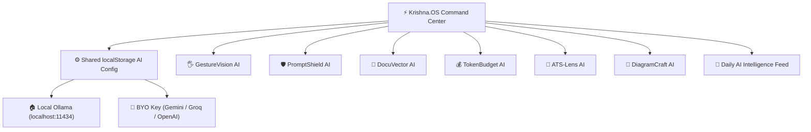

# ⚡ Krishna.OS — Personal AI Command Center

> **Unified Launchpad & Shared Browser AI Engine for Krishna Gupta's Edge AI Micro-App Ecosystem.**

---

## ⚡ Why This Exists

Instead of bookmarking dozens of unrelated links or hunting through ad-filled online utilities, **Krishna.OS** acts as a single `Ctrl+K` Spotlight Command Center hosting all daily AI micro-apps under one unified domain (`https://krishnagupta-coder.github.io/`).

Because GitHub Pages serves every micro-app under the same browser origin, configuring **Local Ollama** or a **BYO API Key** once inside **Krishna.OS** stores it securely in `localStorage` and automatically enables AI mode across downstream apps without any backend server.

---

## 🏗️ Ecosystem Map

---

## 📜 License

MIT License — see [LICENSE](LICENSE).

